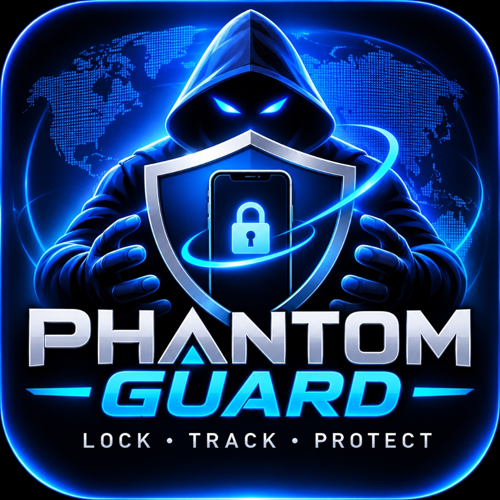
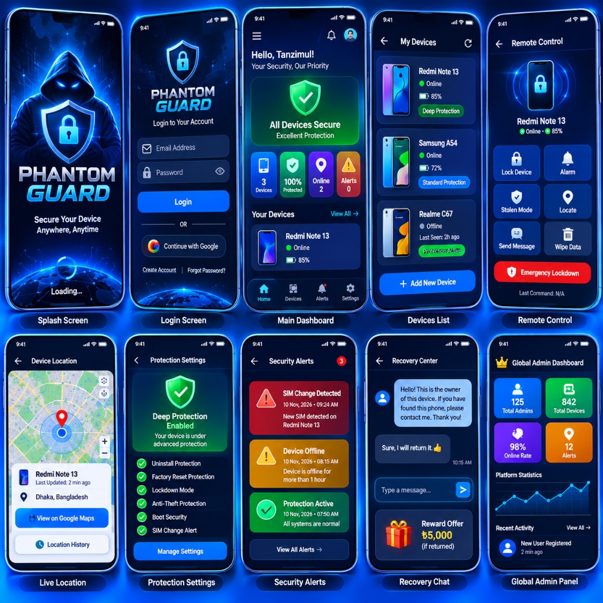

# PHANTOM GUARD — Universal Android Anti-Theft & Device Management Platform

<p align="center">
  
</p>

<p align="center">
  <strong>LOCK • TRACK • PROTECT</strong>
</p>

<p align="center">
  
  
  
  
  
  
</p>

---

## 🛡️ Overview

**PHANTOM GUARD** is a universal Android anti-theft, device recovery, and enterprise device policy platform built for real-world cyber defense. It protects phones across all major manufacturers (**Samsung, Xiaomi, POCO, Redmi, OPPO, Realme, Vivo, Google Pixel, Motorola, OnePlus, Transsion**) with zero paid restrictions.

---

## ✨ Key Capabilities

1. **Universal Compatibility Engine:**
   - Detects Android version, API level (24–35), Security patch, Hardware Keystore, StrongBox, Root indicators (`/system/bin/su`, test-keys), and Bootloader lock status.
   - Dynamic graceful degradation between **Deep Protection (Device Owner DPC)**, **Standard Protection (Device Administrator)**, and **Basic Protection (Foreground Service)**.
   - Tailored OEM power & autostart recommendations for HyperOS, MIUI, One UI, ColorOS, and Pixel.

2. **Android Enterprise Device Policy Controller (DPC):**
   - Official `DeviceAdminReceiver` implementation with hardware `force-lock`, enterprise factory wipe, failed unlock counter, and uninstall blocking.
   - Supports ADB command zero-touch setup and Factory Reset QR provisioning.

3. **Cryptographically Signed Remote Commands:**
   - Destructive actions (Lock, Wipe, Emergency Lockdown) must be signed using **ECDSA P-256** (SHA-256).
   - High-entropy random nonces and 15-minute strict expiration windows eliminate replay attacks.

4. **Dual-Layer Database Sync:**
   - **Local SQLite Database (`phantom_guard.db`):** 100% offline-first local persistence for device state, security alerts, and nonces.
   - **Google Cloud Firestore (Spark Free Tier):** Real-time cloud synchronization of telemetry, commands, alerts, and finder chat.

5. **Recovery Negotiation Center:**
   - Secure anonymous communication channel between honest finders and the phone owner.
   - Custom return proposals and configurable reward pledges (e.g. ৳5,000 / $50).

6. **Responsive Web Dashboard:**
   - Dual-role dashboard supporting **Registered Admins** (device remote control, live GPS radar, alerts) and the **Global Master Admin** (fleet-wide analytics, OEM distribution graphs, telemetry curves, user management).

---

## 📱 User Interface Reference

The application strictly implements the Dark Navy (`#070B19`), Neon Blue (`#1D72FE`), and Cyan Glow (`#00D2FF`) visual design system:

<p align="center">
  
</p>

---

## 🚀 Quick Start Guide

### 1. Android App Build & Installation
```bash
# Clone the repository
git clone <YOUR_GITHUB_REPO_URL>
cd "Phantom Guard Security App/android"

# Compile and assemble debug APK
./gradlew assembleDebug

# Install on connected Android device via ADB
adb install app/build/outputs/apk/debug/app-debug.apk
```

### 2. Device Owner Provisioning (Deep Protection Mode)
```bash
adb shell dpm set-device-owner com.phantomguard.security.debug/com.phantomguard.security.receiver.PhantomDeviceAdminReceiver
```

### 3. Responsive Web Dashboard
```bash
cd "../web-dashboard"
npm install
npm run dev
```
Open `http://localhost:5173` to access the Registered Admin and Global Master Admin portal.

---

## 📂 Repository Structure

```
├── android/                   # Android Studio Project (Kotlin, Jetpack Compose, Clean Architecture)
│   ├── app/src/main/
│   │   ├── java/com/phantomguard/security/
│   │   │   ├── data/          # SQLite Database & Cloud Firestore Sync Manager
│   │   │   ├── domain/engine/ # Compatibility Engine, Command Verifier, SIM Monitor
│   │   │   ├── receiver/      # DeviceAdminReceiver, BootCompleted, SIM State
│   │   │   ├── service/       # Persistent Foreground Security Service & Siren
│   │   │   └── ui/            # Compose Material 3 Screens & Theme
│   │   └── res/               # Device admin policies, themes, vector drawables
├── web-dashboard/             # Responsive React 18 + Vite + Tailwind CSS Web Portal
│   ├── src/screens/           # Registered Admin & Global Master Admin Views
│   └── src/firebase.ts        # Cloud Firestore Real-time Subscriptions
├── backend/                   # Backend Security & Cloudflare Workers
│   ├── firestore.rules        # Strict Cloud Firestore Least-Privilege Rules
│   └── signer-worker/         # Zero-cost ECDSA P-256 Command Signing Microservice
├── assets/                    # Official Branding Logo and UI Interface Collages
└── docs/                      # Complete specifications (Security Audit, Matrix, Schema, Manual)
```

---

## 📄 License & Model
100% Free. No advertisements, subscriptions, or paywalled features.
Designed for personal and enterprise device security.
